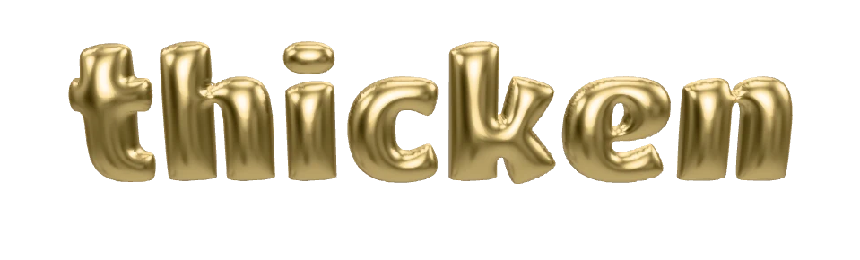
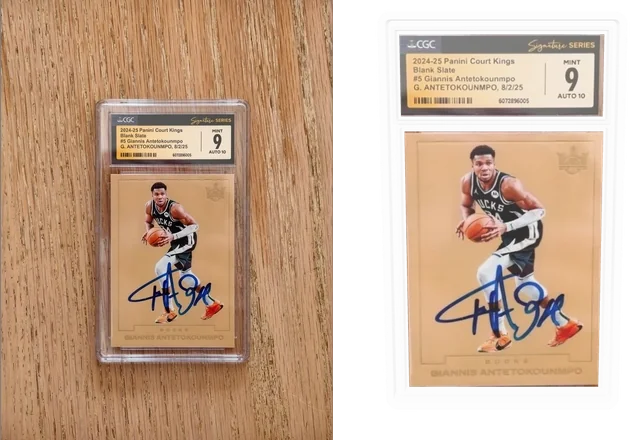
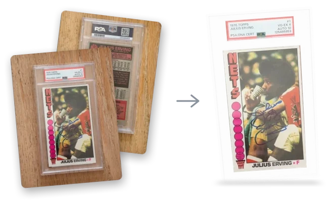
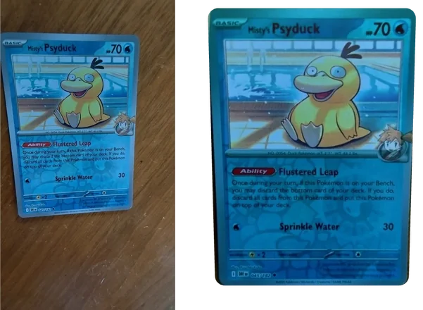
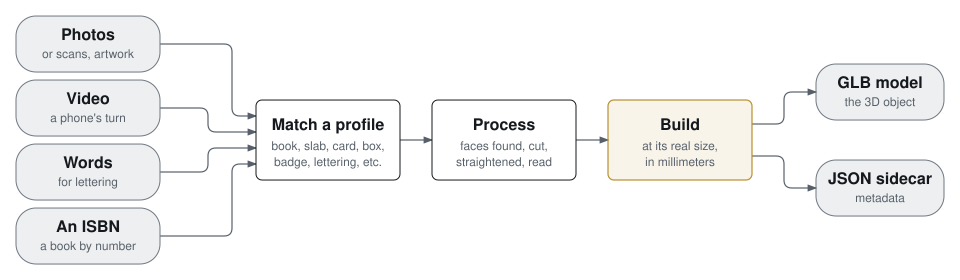

<p align="center">
  
</p>

<p align="center">
  <a href="https://www.npmjs.com/package/thicken"></a>
  <a href="https://github.com/bikemeardsley/thicken/actions/workflows/test.yml"></a>
  <a href="https://registry.modelcontextprotocol.io/?q=thicken"></a>
  <a href="https://skills.sh/bikemeardsley/thicken/thicken"></a>
  <a href="https://cursor.directory/plugins/thicken"></a>
  <a href="https://smithery.ai/skills/bikemeardsley/thicken"></a>
  <a href="https://glama.ai/mcp/servers/bikemeardsley/thicken"></a>
  <a href="https://www.khronos.org/gltf/"></a>
  <br>
  <a href="#development"></a>
  <a href="#try-it"></a>
  <a href="LICENSE"></a>
  <a href="https://buymeacoffee.com/bikemeardsley"></a>
  <a href="https://www.als.net/donate/"></a>
</p>

<h3 align="center">Photos in. Out comes the object: its 3D model and its metadata.</h3>

thicken turns photos of a real object into a **GLB model** at its real size
and its **metadata** as JSON, read off the object by vision models and looked
up in public catalogs. What it knows about each kind of object lives in a
**profile**: a few come with thicken, and you can [add your own](#adding-a-profile).

<p align="center">
  
  
  
</p>
<p align="center"><sub>In each, the photos going in and the model coming out, with its metadata, like the one below. The logo above is a thicken model too, made by its lettering profile: <code>thicken lettering thicken</code>.</sub></p>

**The other half: its metadata.** Part of the first one's, a graded Giannis Antetokounmpo card:

```json
{
  "profile": "slab",
  "holder": "cgc",
  "grader": "cgc",
  "cert": "6072896005",
  "widthMm": 80.5, "heightMm": 135, "depthMm": 7.5,
  "read": {
    "grade": "9", "gradeName": "MINT",
    "autoGrade": "10", "autoGradeName": "AUTO",
    "signed": "G. ANTETOKOUNMPO, 8/2/25",
    "name": "Giannis Antetokounmpo", "year": "2024-25", "maker": "Panini",
    "set": "Court Kings Basketball", "number": "#5", "variant": "Blank Slate"
  },
  "readBy": { "grade": "agreed", "autoGrade": "agreed", "set": "disputed" },
  "inside": {
    "card": { "widthMm": 63.5, "heightMm": 88.9, "corners": "square", "foil": "none" },
    "label": { "widthMm": 66.4, "heightMm": 26.9 }
  }
}
```

The grader and certificate number come from the label's QR code; the vision
models read the rest off the slab. What each profile records is in
[the table of profiles](#what-it-makes), and every field is described in
[USAGE.md](USAGE.md#what-the-sidecar-records).

## Contents

- [Try it](#try-it) · [From an AI agent](#from-an-ai-agent) · [How it works](#how-it-works) · [The thicken object](#the-thicken-object) · [What it makes](#what-it-makes)
- In detail ([USAGE.md](USAGE.md)): [batch](USAGE.md#batch) · [photos](USAGE.md#photos-any-number) ·
  [vision](USAGE.md#vision-optional) · [video](USAGE.md#video-optional) · [training mode](USAGE.md#training-mode-off-by-default) ·
  [review](USAGE.md#review) · [the sidecar](USAGE.md#what-the-sidecar-records) · [previews](USAGE.md#preview) ·
  [inputs](USAGE.md#inputs) · [sizes](USAGE.md#dimensions)
- [What leaves your machine](#what-leaves-your-machine) · [Adding a profile](#adding-a-profile) · [Security](#security) ·
  [Built on](#built-on) · [Development](#development) · [License](#license)

## Try it

```sh
npm install -g thicken                      # Node 22.18 or later; or npx thicken …
thicken photo.jpg                           # it works out what it is: a code on it, or the vision models
thicken book cover.heic back.heic spine.heic
thicken --isbn 9780061120084                # no photo: the cover and size from Open Library
thicken slab front.jpg back.jpg
thicken card front.jpg back.jpg --pt 130    # a thick patch card
thicken badge badge.png --width 50          # cut-out artwork, extruded
thicken lettering thicken                   # the logo
thicken batch ~/Pictures/books --preview    # a model per photo, PDF, video or folder
```

Each run writes `<name>.glb` and `<name>.json` beside the first picture, and
with `--preview` a picture of both sides. Photos straight on and cropped work
as they are; uncropped photos, angled shots and video need a vision roster,
any OpenAI-compatible endpoint ([Vision](USAGE.md#vision-optional)). As a
library: `import { thicken } from 'thicken'`, then `thicken(files, options)`
gives the GLB's bytes and the sidecar.

## From an AI agent

thicken is an MCP server too (`thicken mcp`), with an Agent Skill that tells
the agent when and how to use it: ask for a model of the book on your desk,
and the agent makes it. In Claude Code:

```
/plugin marketplace add bikemeardsley/thicken
/plugin install thicken@thicken
```

Or for any MCP client, `npx -y thicken mcp` on stdio. Codex, Copilot,
Cursor, Gemini CLI and the rest are in [USAGE.md](USAGE.md#from-an-ai-agent).

## How it works

<p align="center">
  
</p>

What thicken knows about a kind of object lives in its **profile**: how to
recognize it, its faces, what to read off it, and how to build it at its real
size. A code on the object picks the profile (an ISBN barcode, a grader's QR
code), or the vision models say which it is. thicken is not a photogrammetry
tool: everything it handles is close to a box or a flat outline, so it builds
the geometry from known sizes and maps your photos onto it.

## The thicken object

What thicken makes is more than a 3D shape. Each run writes a **thicken
object**: the model (a GLB at the object's real size, in millimeters) and,
beside it, its metadata (the JSON sidecar), which knows what the object is, in
its profile's own terms. For the profiles that come with thicken, for
example:

- **A book:** its ISBN, its catalog record (title, authors, publishers,
  dates, subjects, Dewey and Library of Congress classes, pages), and how sure
  the match is when it was found by title.
- **A graded slab:** its grader, cert number and verification link, its
  holder, and the card and label inside it, each sized and placed. With
  vision, the label read: the card's grade (its number and words, "9 MINT",
  any qualifier and subgrades), an autograph's own grade when the label
  grades one apart from the card ("AUTO 10"), who signed it and when, and
  the card as the grader names it.
- **A raw card:** its size, its thickness in points for a thick card, its
  corners and its foil. With vision, what's printed on it: player or
  character, team, year, maker, set, number, parallel.
- **A box:** with vision, its name, brand, edition, rating and year.
- **A badge:** with vision, what it names, who issued it, its level,
  subject, date, any credential number, and every other word on it.
- **Every object:** what the vision models read off it, and how sure;
  which faces are your photos and which are stand-ins,
  how each fact was found, what is still worth photographing, and what each
  vision model answered.

An app shows the model and reads the sidecar: a library shelf of your books,
a vault of your slabs. The fields are under
[What the sidecar records](USAGE.md#what-the-sidecar-records).

## What it makes

thicken makes the 3D object; what it knows about kinds of object lives in
profiles, one file each in `src/profiles`. Anyone can add one
([CONTRIBUTING.md](CONTRIBUTING.md)). Every profile there today:

<!-- profiles:start (made by npm run readme) -->
| Profile | What it is | From | Makes | With vision, reads |
| --- | --- | --- | --- | --- |
| `badge` | cut-out digital artwork: a certification badge, logo or sticker design | Artwork with transparency around its shape (`--width`, `--depth` in mm) | The artwork's own outline, extruded: the art on its face, its edge color on the sides and back | name, issuer, level, subject, date, id, text |
| `book` | a book, hardcover or paperback | Front cover, back, spine and page sides, in any order and any of them; or just an ISBN | The book at its real size, from its ISBN's catalog record: a paperback softly rounded, a hardcover with boards standing past its pages | title, subtitle, authors, series, publisher, edition |
| `card` | a single trading card on its own, not sealed in a plastic holder | Front, and its back | A thin plate, 63.5 × 88.9 mm unless `--size` says, 0.35 mm unless `--pt` gives a thick card's points; its corners cut and its foil shimmering as the vision models see them | name, team, year, maker, set, number, variant |
| `lettering` | words made into puffy 3D bubble letters | Words, typed where pictures would go (`--width` mm across, `--depth` mm thick) | Puffy gold bubble letters, round in section like a balloon, in the Titan One font | – |
| `slab` | a graded trading card sealed in a clear plastic holder with a label | Front, and its back | A clear plastic holder at its grader's size, with the card and the grade label inside it, each cut from the photos | grader, grade, gradeName, qualifier, subgrades, autoGrade, autoGradeName, autograph, signed, cert, name, team, year, maker, set, number, variant |
| `box` | a box-shaped object (a game case, a phone, a deck of cards, packaging) | Front, and any of its back and sides; its size (`--size`), or the vision models' estimate | A softly rounded box with the photos on its faces | title, brand, edition, rating, year |

What each one records in its sidecar, beside what every model has (its size and where it came from, its faces and
pictures, its codes, what the vision models read and how sure, what's worth a second look: all in
[USAGE.md](USAGE.md#what-the-sidecar-records)):

<details><summary><code>badge</code>: edge, regions</summary>

| Field | What it holds |
| --- | --- |
| `edge` | the color just inside its outline, used for its sides and back (#rrggbb) |
| `regions` | how many separate shapes the artwork is (a medal and its ribbon are two) |

</details>
<details><summary><code>book</code>: isbn, catalog, match, pages, binding, bindingBy, measuredBy, depthEstimates, coverUrl, sticker, lookups</summary>

| Field | What it holds |
| --- | --- |
| `isbn` | its ISBN: given, read off its barcode, or from a title match with one edition |
| `catalog` | Open Library's record of the edition and its work: title, authors, publishers, dates, edition, format, series, languages, subjects, Dewey and LC classes, contents, every id, links, cover |
| `match` | when found by the title read off it: what was read, how sure the match is, the work and its editions |
| `pages` | its page count |
| `binding` | hardcover or paperback |
| `bindingBy` | how that was found: vision, catalog or assumed |
| `measuredBy` | where each of its sizes came from: measured, openlibrary, loc, googlebooks, pages, photos, cover or trim |
| `depthEstimates` | every thickness estimate made: from the photos and from the page count |
| `coverUrl` | Open Library's cover, when it stands in for a front not photographed |
| `sticker` | where a foil seal or sticker is on its front cover |
| `lookups` | every catalog request: host, path, status and time |

</details>
<details><summary><code>card</code>: corners, cornersBy, foil, foilBy, pictureBox, pictureBoxBy, pt, measuredBy</summary>

| Field | What it holds |
| --- | --- |
| `corners` | how its corners are cut: square, slight or round |
| `cornersBy` | how that was found: vision or assumed |
| `foil` | its foil: none, holo (the picture shines), reverse (all but the picture) or full |
| `foilBy` | how that was found: vision or assumed |
| `pictureBox` | where its picture box is, in fractions of the front, for holo and reverse foil |
| `pictureBoxBy` | how that was found: vision or the standard layout |
| `pt` | a thick card's thickness in points, when given |
| `measuredBy` | where its size came from: standard or given; its thickness: standard, given or pt |

</details>
<details><summary><code>lettering</code>: text, font, fontLicense, color, measuredBy</summary>

| Field | What it holds |
| --- | --- |
| `text` | the words, as lettered |
| `font` | the font they were drawn in |
| `fontLicense` | its license (OFL-1.1) |
| `color` | their color |
| `measuredBy` | where its width and depth came from: given, the default, or round in section |

</details>
<details><summary><code>slab</code>: grader, cert, verifyUrl, holder, inside, measuredBy</summary>

| Field | What it holds |
| --- | --- |
| `grader` | who graded it: psa, bgs, cgc, sgc or tag, from its QR code or its label |
| `cert` | its certification number |
| `verifyUrl` | the grader's page for this cert, from its QR code |
| `holder` | the holder it was built as (psa, cgc-tall…) |
| `inside` | the card and the label inside: each one's size, middle and what placed it; the card's corners and foil; where the label's hologram is |
| `measuredBy` | where its size came from: the holder table, or measured |

</details>
<details><summary><code>box</code>: barcode, measuredBy</summary>

| Field | What it holds |
| --- | --- |
| `barcode` | its product barcode (UPC or EAN) and its kind, when a photo shows one |
| `measuredBy` | where each of its sizes came from: measured, or the vision models' estimate |

</details>
<!-- profiles:end -->

Name the profile, or leave it out and thicken picks one:

- An ISBN barcode on any picture, or `--isbn`, means a **book**.
- A QR code pointing at a grader's site (psacard.com, beckett.com,
  cgccards.com, gosgc.com, taggrading.com) means a **slab**, and says whose.
  The sidecar keeps the grader, the cert number from the link, and the link
  itself (`verifyUrl`).
- So does an older label's Code 128 cert barcode, but only on a photo shaped
  like a holder. The grader is then the one the vision models read off the
  label; with no vision, a PSA-size holder is assumed, with a warning.
- Artwork with transparency around a shape that isn't just a rectangle means
  a **badge**.
- Otherwise, with [vision](USAGE.md#vision-optional), the models are shown the
  profiles and say which it is, and roughly how big: two agreeing settle it,
  as with faces, and `box` takes anything box-shaped the others don't cover.
- Anything still unknown is refused with a request to name the profile.
  Other barcodes don't count: books carry UPCs, QR codes and library
  stickers.

The sidecar's `identifiedBy.profile` says which way it was chosen: `given`,
`recognized` (codes or the artwork), or `vision`.

**Adding a profile** is one file in `src/profiles`, found by itself, nothing
else to change: its name; a few words on what it is and on each of its faces,
which is all the vision models are told; what to read off it (more is better:
the sidecar is for apps to take what they want from); optionally how its codes
or pictures give it away unaided; and how to build it from the photos placed
on its faces. Generic profiles are named for the shape they build (`box`, and
later perhaps `flat` or `cylinder`), not "unknown": a shape thicken can't
build is refused rather than forced into one it can. Contributions welcome:
[CONTRIBUTING.md](CONTRIBUTING.md) says how.

Pictures are placed on faces by what they show (see
[Photos](USAGE.md#photos-any-number)). With no front, Open Library's cover stands in,
marked for review, so one photo of the back is enough to start a book.

## What leaves your machine

With `THICKEN_VISION_URL` set, the photos
themselves (re-encoded, so without their EXIF) go to that host. A LAN server
you control still forwards each photo to the model's provider; a hosted
endpoint sees every photo. The only other calls out are a book's catalog
lookups (Open Library, the Library of Congress, Google Books), which send its
ISBN, or the title and author the models read off it; never a photo.

Nothing else is sent anywhere, and nothing is fetched at run time but those
lookups: previews draw with model-viewer served from your own disk.

## Adding a profile

A profile is one file, found by itself: what the object is, its faces, what
to read off it, and how to build it. Make your own while you use thicken, or
improve one of its own, and offer it back:

```sh
thicken profile new vinyl          # from the template, in ~/.thicken/profiles: used at once
thicken profile check vinyl        # what thicken's CI will check
thicken profile contribute vinyl   # forks, branches, checks and opens the pull request
```

The template, [templates/profile.ts](templates/profile.ts), works as it is (a
box at the size you give) and says on every field what goes there, the
records it writes included. [CONTRIBUTING.md](CONTRIBUTING.md) has the rest.
The table above is made from the profiles themselves.

## Security

Report a vulnerability privately, as [SECURITY.md](SECURITY.md) says. It also
lists what thicken touches: files, the network, and the programs it runs.

## Built on

| Part | How | Choice |
| --- | --- | --- |
| Triangulating badge outlines | Dependency | [mapbox/earcut](https://github.com/mapbox/earcut) (ISC) |
| Writing GLB | Dependency | [donmccurdy/glTF-Transform](https://github.com/donmccurdy/glTF-Transform) (MIT) |
| Decoding HEIC | Dependency | [catdad-experiments/libheif-js](https://github.com/catdad-experiments/libheif-js) (LGPL-3.0, used unmodified). sharp's binaries leave out HEVC. |
| Reading barcodes | Dependency | [Sec-ant/zxing-wasm](https://github.com/Sec-ant/zxing-wasm) (MIT). Its `.wasm` is loaded from `node_modules`, not its default CDN. |
| Pictures from scanner PDFs | Dependency | [unjs/unpdf](https://github.com/unjs/unpdf) (MIT, pdf.js inside) |
| Frames from video | Outside program | [FFmpeg](https://ffmpeg.org), run from the `PATH`, never bundled: it is GPL, thicken MIT. [eugeneware/ffmpeg-static](https://github.com/eugeneware/ffmpeg-static) (GPL-3.0) would put a GPL binary in every install, video or not; [ffmpegwasm/ffmpeg.wasm](https://github.com/ffmpegwasm/ffmpeg.wasm) is built for browsers. Choosing the frames is ours. |
| Reading camera details (EXIF) | Dependency | [devongovett/exif-reader](https://github.com/devongovett/exif-reader) (MIT): parses the EXIF block sharp returns |
| Drawing previews | Dependency | [google/model-viewer](https://github.com/google/model-viewer) (Apache-2.0): frames and lights a GLB; three.js inside |
| Running the preview browser | Dependency | [microsoft/playwright](https://github.com/microsoft/playwright) (`playwright-core`, Apache-2.0): drives an installed Chrome or Edge, no browser download |
| Book dimension sources | Write | Read [palmerabollo/node-isbn](https://github.com/palmerabollo/node-isbn)'s provider fallback. Ours is per dimension, not first-provider-wins. The Library of Congress's one field (MARC 300) is read with a regular expression, not a MARC library. |
| Hardcovers | Write | Four rounded boxes from `src/glb.ts`, and the binding asked of the vision models like a card's corners. |
| Holofoil | Write | Which areas shine for each kind of foil read from [simeydotme/pokemon-cards-css](https://github.com/simeydotme/pokemon-cards-css) (GPL-3.0: facts read, nothing copied); the film values are `KHR_materials_iridescence`'s defaults, as [KhronosGroup/glTF-Sample-Assets](https://github.com/KhronosGroup/glTF-Sample-Assets) uses them; glTF-Transform, already a dependency, writes the extension. |
| Profiles, box, classifier, CLI | Write | |
| Slab holder, card and label | Write | glTF-Transform's materials (already a dependency) for the clear holder; the card and label plates, where they sit, and putting them together are ours. Khronos's [glTF-Sample-Assets](https://github.com/KhronosGroup/glTF-Sample-Assets) were the reference for clear materials. |
| Finding faces in photos | Write | Vision models over any OpenAI-compatible endpoint, primary and peer (src/vision.ts): one POST each, no SDK. |
| Straightening faces | Adapt, don't depend | [jlouthan/perspective-transform](https://github.com/jlouthan/perspective-transform) (MIT): the 4-point homography; the resampling over sharp's pixels is ours. sharp has no perspective warp, and OpenCV.js is megabytes for one. |
| Snapping corners to edges | Write | `snap` in src/image.ts moves a model's corners (about 1% off) onto the real edges. It samples brightness steps along each side, takes the line they support nearest the model's, and fits it by least squares, in about 70 ms a face. [puffinsoft/jscanify](https://github.com/puffinsoft/jscanify)'s corner ranking was read; a line fit near the model's corners was enough. |
| Lettering's font | Dependency | [opentypejs/opentype.js](https://github.com/opentypejs/opentype.js) (MIT) reads it: the words' outlines, kerned. The font is [Titan One](https://github.com/google/fonts/tree/main/ofl/titanone) by Rodrigo Fuenzalida, shipped unmodified under the SIL Open Font License 1.1 (`fonts/OFL.txt`; "Titan" is its Reserved Font Name). |
| Inflating letters | Adapt, don't depend | Each pixel's distance from the outline is [mapbox/tiny-sdf](https://github.com/mapbox/tiny-sdf)'s (BSD-2-Clause) exact distance transform, ported; it places the outline to a fraction of a pixel. The rise is ours: √u, where ∇²u = −2 inside the letters, round in section across any stroke. |

For refractor and holo effects in a viewer, `simeydotme/pokemon-cards-css` is
a reference only. It is GPL-3.0, so read it and don't copy it.

## Development

TypeScript on Node 22.18+, with `sharp` for images. From a clone it runs
directly (Node strips the types). The npm package is JavaScript built into
`dist` (`npm run build`, run by `npm pack` and `npm publish`), because Node
won't strip types inside `node_modules`. Every push installs the packed
package on Windows, macOS and Linux and runs it.

From a clone: `npm install`, then `node src/cli.ts …` in place of
`thicken …`; `npm test`, `npm run check`, and `npm run readme` after
changing a profile.

## License

MIT. See [LICENSE](LICENSE).

The lettering font, Titan One, is under the SIL Open Font License 1.1
([fonts/OFL.txt](fonts/OFL.txt)).
